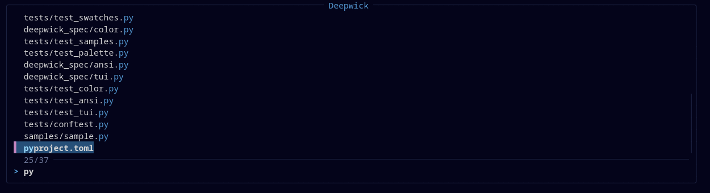

# Deepwick for fzf

Deepwick colors for [fzf](https://github.com/junegunn/fzf).

> Deepwick is an unofficial theme derived from
> [Polywick Blue](https://vscode.polywickstudio.net) by Polywick Studio (MIT).
> Not affiliated with Polywick Studio.



## Install

bash or zsh — add to `~/.bashrc` or `~/.zshrc`:

```sh
source /path/to/deepwick.sh
```

fish — add to `~/.config/fish/config.fish`:

```fish
source /path/to/deepwick.fish
```

Both append to `FZF_DEFAULT_OPTS`, so your other fzf options are kept.

## Notes

- The current line uses the Selection background; matches are Blue, and
  Light Blue on the current line.

Tested with fzf 0.73.1.

## License

MIT. See [LICENSE](LICENSE).
